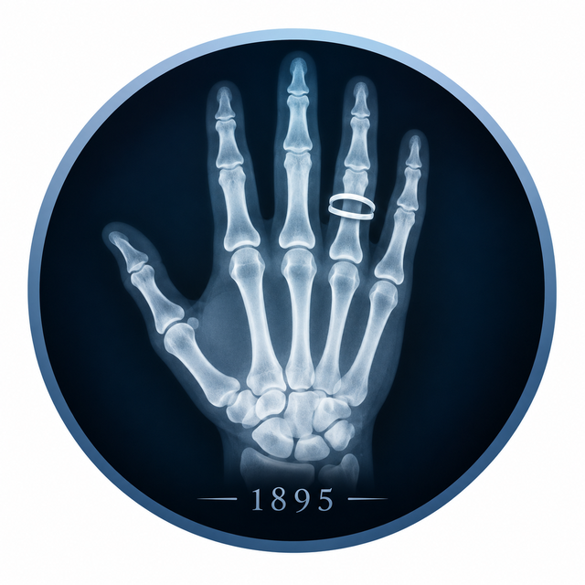

# Skiagrama

<p align="center"></p>

**Версія 0.4 · бета** · автор: [bezeza](https://github.com/bezeza)

> Бета-версія: основні функції готові, програма проходить перевірку в реальній роботі. Повідомляйте про помилки та ідеї.

АРМ лікаря-рентгенолога: протокол рентгенологічного дослідження кнопками за хвилину. Працює без інтернету, дані пацієнтів не залишають пристрій.

**Відкрити:** https://bezeza.github.io/skiagrama/

**Офлайн-файл (один HTML):** https://bezeza.github.io/skiagrama/skiagrama.html — відкрийте й збережіть сторінку («Зберегти як…»).

## Що вміє
- ОГК, флюорографія, кістки й суглоби, хребет, ОЧП, череп і ППН.
- «Норма всюди», опис по зонах з кольоровим станом, власні кнопки-фрази, підказки висновку.
- Вимірювання: КТІ, кут Кобба, кіфоз, лордоз, Genant, кути стопи, кульшового суглоба, кут Белера.
- Чотири бланки: A — офіційний, B — сучасний, C — компактний під штамп, D — форма з полями; реквізити закладу в налаштуваннях.
- Друк на пів аркуша A4 з автопідгонкою (до 11 pt); довгий протокол — на цілий аркуш з одного боку. Програма радить бланк і пояснює чому.
- «Перегляд перед друком»: протокол у вибраному бланку, як ляже на папір.
- Вигляд під екран: ноутбук чи монітор, чотири розташування (класичне, робоче місце, дзеркальне, один стовпчик), масштаб усієї програми 90–150 %, згортання будь-якого блоку в рядок.
- Мінімальний редактор: жирний, курсив, підкреслений, вирівнювання — зберігається на друці, у PDF і Word.
- Протокол правиться прямо в тексті; кнопки зон редагуються олівцем ✎ (напис, фраза, порядок, сховати, додати).
- Пакети фраз і типові описи: встановлення з каталогу або файлу, підпис автора (ПІБ, стаж, дата затвердження), повернення як було. Вбудована чернетка «Типові описи ОГК і кісток» — для перевірки рентгенологом.
- Друк пачкою: половинки парами, повні аркуші окремо. «Зберегти як»: PDF (A5 / A4), Word, LibreOffice.
- Папка даних: архів по місяцях, копія кожного протоколу як аркуша, пакет фраз, щоденні копії.
- Швидкість: подвійне клацання міняє «справа ↔ зліва», скорочення «.кт» + пробіл → фраза, пропуски «__» з переходом по Tab.
- Безпека висновку: попередження, якщо у висновку патологія, а її зона в нормі; результат «норма / патологія / дообстеження» з фільтром і списком в архіві.
- Перевірка «право / ліво», мітка «Терміново», кілька досліджень одному пацієнту, вивантаження архіву в Excel.
- Архів протоколів, «На контроль», «Як минулого разу», шаблони лікаря, потоковий режим флюорографії.
- Пошук Ctrl+K, гарячі клавіші як у «Первинному огляді», повтор дії Ctrl+Y.
- [Памʼятка на 1 сторінку](https://bezeza.github.io/skiagrama/pamyatka.html) для рентгенолога й лаборанта.

## Встановлення
- **ПК (Chrome / Edge):** відкрити адресу → «Встановити» вгорі або значок установки в адресному рядку.
- **Android (Chrome):** меню ⋮ → «Установити застосунок» / «Додати на головний екран».
- **iPhone (Safari):** «Поділитися» → «На екран „Додому“».

Після першого відкриття програма працює без інтернету. Коли інтернет є — пропонує оновитися.

## Дані пацієнтів
Програма не надсилає жодних даних і не звертається до сторонніх серверів (шрифти вбудовані у файл). Архів зберігається в сховищі браузера IndexedDB (десятки тисяч протоколів), шаблони й налаштування — у браузері; усе це лише на пристрої.

**Папка даних (Chrome або Edge на комп’ютері):** «Налаштування» → «Створити / обрати папку даних». Програма створить папку «Skiagrama — дані» і сама зберігатиме туди архів, шаблони, налаштування й щоденну копію.

На телефоні та в браузерах без папки даних робіть резервну копію в «Архіві» («Зберегти копію архіву») — програма раз на день нагадує про це після збереження протоколу.

Програма готує текст протоколу; остаточне рішення та підпис — за лікарем.

## Для розробників
```
src/head.html, styles.css, body.html, pwa.js   — оболонка сторінки
src/memo.html, memo.css                        — памʼятка (вбудовується в програму і збирається в pamyatka.html)
src/js/NNN-назва.js                            — блоки скрипту (спільна область видимості, порядок важливий)
build.mjs                                      — збирання → index.html (сайт), skiagrama.html (офлайн), версія кешу в sw.js
tests/run.mjs                                  — автоматичні перевірки (Playwright, ПК і телефон) і модульні: шаблони всіх зон, підказки, друк
```
```
npm run build   # зібрати
npm test        # зібрати і перевірити
```
Тести запускаються й на GitHub при кожному коміті (`.github/workflows/test.yml`).

Правки робіть у `src/`; `index.html` і `skiagrama.html` перезаписуються під час збирання. Версія — `VERSION` і `CHANGELOG` у `src/js/030-version.js`.

## Іконки
- [Phosphor Icons](https://phosphoricons.com) — MIT
- [Healthicons](https://healthicons.org) — MIT (медичні: легені, рентген, хребет, шлунок, череп)
- [Hugeicons](https://hugeicons.com) — MIT (кістка)

## Шрифти
Rubik, IBM Plex Sans, IBM Plex Serif — SIL Open Font License 1.1 (пакети [Fontsource](https://fontsource.org)); файли й ліцензії — `src/fonts/`.

## Ліцензія
GNU GPL v3 — див. файл LICENSE. Програма надається «як є», без жодних гарантій.
